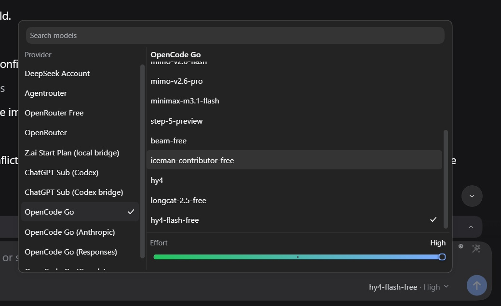

# dsh-model-picker


The stock DeepSeek Harness composer opens a separate two-level model menu. This plugin puts provider,
model and reasoning effort in one panel, and searches model names across all providers.

To install, hand this link to your DSH agent: `https://github.com/chstd/dsh-model-picker`.



## Why this exists

- Switching provider, model and effort takes several steps in the stock control.
- This plugin keeps all three visible in one panel.
- Search across providers saves remembering which provider owns a model.
- The effort you pick stays visible while you change models.

## Status

- Version 1.0.0.
- Live-verified in DeepSeek Harness 0.2.2-rc.1, web profile.
- It replaces the stock composer model control. Removing the plugin restores that control.
- Installation needs no host restart, only a page refresh.

## Install

The simplest way is to let your DSH agent do it. Send this line to the chat:

```
Install this DSH plugin: https://github.com/chstd/dsh-model-picker
```

The agent clones the repository, installs the bundle and tells you when to refresh the page. Nothing to
configure by hand, and no host restart is needed. The agent just needs network access to GitHub.

Installing by hand works too and takes a few more steps: clone the repository on the machine that runs
DSH, then install that folder as a bundle with
`plugin_manager action=install_bundle target=<the cloned folder>`.

## Use

- The trigger shows the current model and effort.
- The left column selects the provider.
- The right column lists that provider's models.
- The search at the top spans all providers and groups results by provider.
- The effort slider appears only for models that advertise reasoning levels.
- The panel stays open after a choice, so model and effort can be set in one visit.
- Keyboard: `Up`/`Down` move the highlight, `Enter` selects, `Left`/`Right` switch providers,
  `Ctrl+T` focuses the effort slider, `Escape` closes.
- The control is disabled while the composer is busy.
- Added subagent sessions keep the stock behaviour.

## What the selection changes

Picking a model updates the current chat and saves the selection as the deployment default for new
chats. The reasoning level is carried over when the target model advertises it; otherwise the model
default is used.

## Limits

- No arbitrary effort values.
- No settings-page link.
- It replaces the built-in model control; both controls do not appear together.

## Licence

MIT. See [LICENSE](LICENSE).
